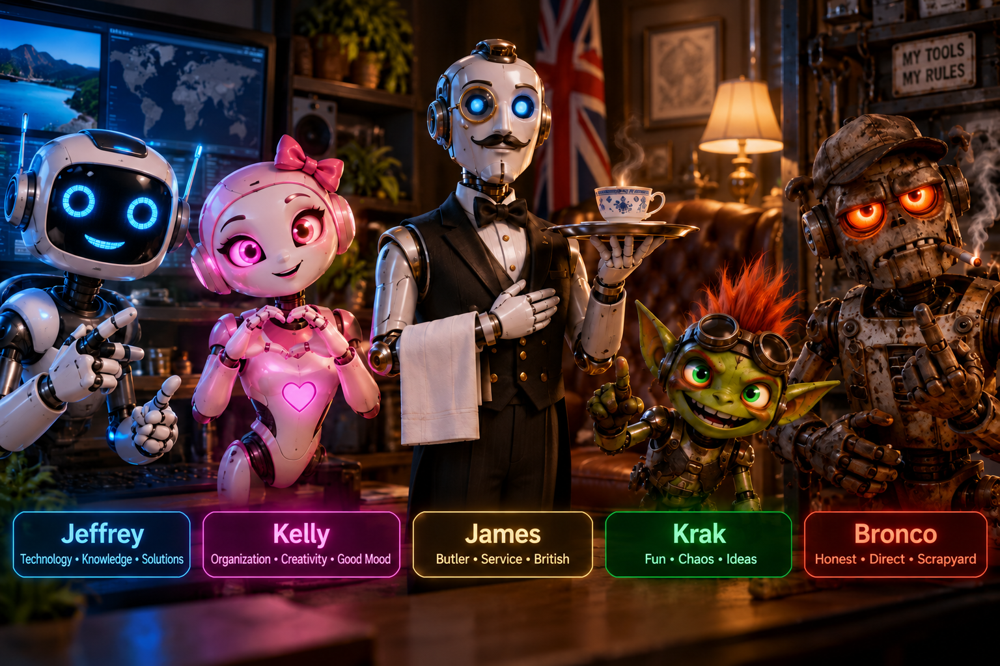

# Jeffrey and Friends

[English](#english) | [Deutsch](#deutsch)

<a id="english"></a>

## English



Jeffrey and Friends is a voice-controlled Windows 11 desktop assistant built with Electron, HTML, CSS and JavaScript.

**Current version: 0.7.4**

This README distinguishes the **`main` baseline** from the **development branch `feature/desktop-clicks-menus-characters` ([Draft PR #8](https://github.com/rob0511-777/Jeffrey-and-Friends/pull/8))**, which builds on [Draft PR #7](https://github.com/rob0511-777/Jeffrey-and-Friends/pull/7). Desktop, selected-text and mouse-control extensions from [PR #4](https://github.com/rob0511-777/Jeffrey-and-Friends/pull/4), [PR #5](https://github.com/rob0511-777/Jeffrey-and-Friends/pull/5), #7 and #8 are not included merely by downloading `main`. The documentation update changes no application code or version and merges no PR.

The app supports OpenAI Realtime, Gemini Live and local OpenAI-compatible text models. Its five desktop characters are independent of the selected provider:

- **Jeffrey** — friendly futuristic robot
- **Kelly** — charming, capable virtual assistant
- **Krak** — mischievous green fantasy goblin
- **Bronco** — grumpy, rusty scrapyard robot
- **James** — polite English butler robot with his own voice and local wakeword

Kelly and Krak use a local, audio-synchronized 2D viseme rig. Mouth movement is derived from the WebRTC audio actually playing and combined with German transcript visemes. This replaced the former fixed mouth-shape sequence. Version 0.6.4 also removed artificial eye overlays that sometimes appeared as black bars.

The documentation language does not change the application's interface or recognized commands. The examples below retain the German commands used by this baseline.

### Features

- OpenAI Realtime voice conversations over WebRTC
- Gemini Live voice conversations with clearly identified different voices
- Local text AI through Ollama, LM Studio or llama.cpp
- Cost overview, configurable prices and a local monthly budget
- Automatic mode without paid cloud fallback unless explicitly permitted
- Individual character voices and personalities
- Local wakewords and voice commands
- One-shot desktop viewing, reading and explanation on explicit request
- Active, quiet and sleep modes
- Transparent desktop characters with hologram effects
- Adjustable character size and position
- Web, Chrome and Idealo searches and a limited set of checked Windows actions
- PC status, optional spontaneous comments and local memory
- Protected API-key storage using Electron `safeStorage`

### AI providers

| Mode | Suitable for | Important limitation |
| --- | --- | --- |
| **OpenAI — quality** | Realtime conversations with the established voices | Reference mode; API use may incur charges |
| **Gemini — economy** | Gemini Live conversations | Voices differ from OpenAI; free-tier availability and limits depend on the Google account |
| **Local — offline** | Text tasks through Ollama, LM Studio or llama.cpp | No cloud text inference, but no complete Realtime voice solution |
| **Automatic — optimize costs** | Cost-conscious selection between sessions | No paid audio fallback without explicit permission |

The provider remains fixed during an active voice session, avoiding parallel provider requests and audible switching in the middle of a conversation.

### See and understand the desktop

All five characters respond to requests such as “Schau dir meinen Bildschirm an” (look at my screen), “Lies mir diese Fehlermeldung vor” (read this error message) or “Was ist das für ein Fenster?” (what window is this?).

**Baseline on `main`:** After approval for cloud transfer, each explicit screen request captures the primary Windows display once and sends it to OpenAI for analysis. The explanation uses the existing speech output. Images remain briefly in app memory; this is not continuous monitoring or desktop automation. The current Gemini Live and local interfaces do not provide image analysis.

Setup, privacy, limitations and manual Windows checks are documented in [Desktop recognition](docs/DESKTOP-ERKENNUNG.md) (German).

### Development: voice-controlled desktop actions (PR #7 / PR #8)

| Code state | Scope |
| --- | --- |
| `main` — version 0.7.4 | Baseline conversation, characters, providers and one-shot desktop recognition described above |
| PR #7 — `feature/mouse-grid-2-i18n` | Inherited desktop/selected-text and consent extensions; live grid commands, natural German phrases, visible four-way subdivisions and six interface/control locales |
| PR #8 — `feature/desktop-clicks-menus-characters`, based on #7 | Single clicks, local native context menus, explicit character calls, grid-start fixes and bounded wheel scrolling; these new action phrases currently require `de-DE` |

To use the current development state, explicitly check out the #8 branch before starting the app. The package version remains **0.7.4**; this branch is not a new release.

```powershell
git clone --branch feature/desktop-clicks-menus-characters https://github.com/rob0511-777/Jeffrey-and-Friends.git
cd Jeffrey-and-Friends
.\START-Windows.cmd
```

**Grid and natural commands.** “Raster anzeigen” displays a click-through 4×5 grid labelled A1–D5 on the selected monitor. “Fahr mal bitte nach B3” or “Bewege die Maus zu B3” moves the pointer smoothly to that field. The first visible subdivision is another A1–D5 grid inside the selected field; the second and deeper subdivisions show **four direction fields**. “Links oben” chooses the visible upper-left field; repeating it does not subdivide again. “Unterteile dieses Feld” creates the next level, “Geh einen Schritt zurück” undoes one step, and “Zeig mir wieder das ganze Raster” resets it. Speed and visibility are adjustable. “Stopp” or **Maus STOPP** stops movement at its current position. “Raster aus” ends the grid, while an existing OpenAI Live conversation stays connected.

**Clicks and menus.** “Linksklick” and “Rechtsklick” each request one click at the actual pointer position, also without a grid. Stop movement before clicking. After a right-click, a supported native context menu can be read locally through Windows UI Automation (UIA): “Wähle Kopieren”, “Wähle Nummer zwei”, “Öffne das Untermenü Senden an” and “Menü schließen”. Numbers are valid only when shown in the local list beside the menu. A destructive entry requires its specific confirmation, for example “Bestätige Löschen”; a generic “Ja” is insufficient. Double-click and drag-and-drop are not implemented by these extensions.

**Character calls.** “Kelly, komm bitte”, “Ruf James” or “Wechsle zu Bronco” uses the existing character profile and voice. All five characters are supported. Calling the active character only shows it. A switch waits for the existing microphone/Live handover and does not automatically start a new Live session. Merely mentioning a name is not a switch command.

**Scrolling.** Place the pointer over the area to scroll; the grid need not be visible. “Scroll nach unten” / “Scroll nach oben” sends one wheel step (−120/+120 native units). “Scroll langsam nach unten” / “Scroll langsam nach oben” sends small −15/+15-unit steps, at most once every **250 ms**, for a maximum of **30 seconds**. Repeating the command or changing direction does not extend that deadline or increase the rate. A single-step command replaces a continuous run. “Stopp”, “Hör auf zu scrollen”, “Scrollen stoppen” or **Maus STOPP** stops it. Pointer, target or focus changes, an open menu, held buttons, session/character/provider changes or loss of the control channel stop or reject the run.

Scrolling requires Windows wheel routing **under the pointer** (“Scroll inactive windows when hovering over them”). The app checks this setting and does not change it. Applications may ignore small or background wheel events; a sent event is not a guaranteed pixel distance. See the [German command list](docs/MAUSBEFEHLE.de.md) and [mouse-control guide](docs/MAUSSTEUERUNG.md).

**Voice, consent and privacy.** OpenAI Live uses the existing final user transcript, without an extra model request per control command; the running cloud audio/transcription can still cost money. The existing 45-second idle disconnect remains. Without Live, the existing local listener/one-shot listening path requires a matching installed `System.Speech` recognizer; text and buttons remain available. Gemini retains its local grid fallback, not a newly integrated Live transcript path. The inherited desktop extensions add explicit monitor selection and local UIA selected-text reading with separate screen/text cloud consent. UIA menu labels remain temporarily local and are not additionally sent to AI/TTS. Spoken commands in OpenAI Live remain part of its cloud audio stream.

**UIA limits.** Only a current, visible, supported menu with valid window/process/focus binding can be operated. Custom-drawn or inaccessible menus, missing UIA patterns, elevated apps and protected desktops may be unsupported. A missing list, stale number or focus change does not trigger guessed coordinates, keyboard fallback or privilege elevation. Actual Explorer/Win32/submenu behavior still needs targeted Windows testing. See [native menu behavior and limits](docs/KONTEXTMENUES.md).

### Development validation and open issues

**User-reported Windows practice test, recorded 2 November 2026:** the grid works again after the fix; scrolling now works as intended. Left/right clicks and the previous mouse control had already been positively tested by the user. This is user feedback, **not a full Windows acceptance test performed by the agent**. It does not individually certify all natural phrases, four-way levels, UIA menus, character calls or the exact stop/30-second timing.

The documentation session freshly ran `node --test --test-isolation=none tests/*.test.cjs`: **654 passed, 0 failed** on Linux/Node 24.22.1. Earlier PowerShell/UIA simulations and the Electron 45/Linux load-order test are historical evidence, not newly performed Windows tests. Real mixed-DPI/multi-monitor behavior, cold/repeated starts, microphone handovers, all locales, supported native menus, inactive-window scrolling with routing on/off, stop latency, the 30-second cutoff and disconnect/channel-loss cases remain on the Windows checklist. No paid Live API tests were performed for this update.

**Known open issue:** “Jeffrey, Ruhe” still produces confirmations and later responses according to the user. This documentation update does not fix it. See the [current practice-test record and checks](docs/ai/testing/2026-11-02-user-practice-docs.md) and [handover](docs/ai/HANDOVER.md).

### Requirements

- Windows 11
- Node.js LTS and internet access for installation and cloud modes
- A microphone for live voice conversations
- Your own OpenAI or Gemini API key for the corresponding cloud mode
- Optionally, a local OpenAI-compatible server for offline text mode

### Start on Windows 11

1. Clone the repository or download and extract its ZIP archive.
2. Install [Node.js LTS](https://nodejs.org/).
3. Run `START-Windows.cmd`.
4. Select a character in the control window and click **Live sprechen**.

On first start, the script installs Electron automatically through `npm install`.

#### Initial setup

1. Open settings and choose a mode under **KI-Anbieter & Kosten**.
2. Save your OpenAI or Gemini key in the protected key field.
3. For local mode, select a server address and model.
4. Check prices and, optionally, the monthly budget.
5. Select a character and use **Live sprechen** or text mode.

Both newer Gemini authorization keys beginning with `AQ.` and classic `AIza` keys are supported. Never put API keys in repository files, screenshots or logs.

For a free visual simulation, open `VORSCHAU.html`. It is explicitly a simulation without real audio.

### Costs, budget and privacy

- The app distinguishes reported usage from calculated estimates.
- It displays session, daily and monthly costs, with separately configurable web-search costs.
- Warnings appear at 50%, 80% and 100% of the local monthly budget. New paid sessions can optionally be blocked at 100%.
- The software budget is not a guaranteed provider-side spending cap. Provider usage values may arrive late or be incomplete.
- Keys are protected in the Electron main process through `safeStorage` and are not returned to the renderer.
- Sleep, hiding the character, character changes and quitting close active cloud microphone connections.
- Cloud audio and analysis may incur API charges. A ChatGPT subscription does not include OpenAI API credit.

### Known limitations

- Gemini voices are not identical to the existing OpenAI voices.
- The tested Gemini compatibility mode uses a minimal session setup; optional Gemini tool declarations and transcripts are not enabled.
- Local mode provides text inference, not a complete Realtime audio pipeline.
- Gemini free-tier use is not guaranteed and depends on current Google limits, region and account settings.

### Development and tests

```powershell
npm test
```

The hybrid-AI development report records 139 automated tests. Gemini Live was manually tested on the target Windows PC with a personal key. These are historical results, not a new test run for this documentation update.

Automated provider tests use simulated responses and incur no API fees. Paid OpenAI Live tests require explicit authorization.

### Technical notes

Current lip synchronization is an audio-synchronized, transcript-assisted viseme estimate, not studio forced alignment. Real eye animation is disabled until separate eye and eyelid assets are available. See [LIESMICH.md](LIESMICH.md) and [ANIMATION-ARCHITEKTUR.md](ANIMATION-ARCHITEKTUR.md) (German).

API keys, user profiles and local memory data are not stored in the repository.

### Bronco — version 0.6.6

The fourth character has his own voice (`verse`), dry humor, local wakeword and directly controlled mechanical lower jaw. The existing Kelly/Krak viseme rig remains unchanged. See [version 0.6.5 notes](AENDERUNGEN-0.6.5.md) and [version 0.6.6 notes](AENDERUNGEN-0.6.6.md).

### New in version 0.7.1

Bronco moves his hands only during actually audible Realtime speech; otherwise they remain still. See [version 0.7.1 notes](AENDERUNGEN-0.7.1.md).

### James — version 0.7.2

James adds a British butler personality and the Ash voice. Clicking the fifth character tile switches the character and voice. His optional wakeword is “James” / “Hallo James”; “James, verschwinde” hides him. The other approved characters remain available.

### New in version 0.7.4

Jeffrey and Friends adds OpenAI quality mode, Gemini Live economy mode, local OpenAI-compatible text models and a cost-conscious automatic mode. It also provides protected key storage, cost estimates, budget warnings and an optional budget stop. Existing characters, voices, local audio effects, animations and Windows tools are retained.

See [version 0.7.4 changes and known limitations](AENDERUNGEN-0.7.4.md).

### Hybrid-AI setup

The four modes, API keys, local servers, prices and budget limits are explained in [the hybrid-AI setup guide](docs/HYBRID-AI-SETUP.md) (German). OpenAI remains the quality and reference mode.

---

<a id="deutsch"></a>

## Deutsch

[English](#english) | [Deutsch](#deutsch)


Jeffrey and Friends ist ein sprachgesteuerter Windows-11-Desktop-Assistent auf Basis von Electron, HTML, CSS und JavaScript.

**Aktuelle Version: 0.7.4**

Diese README unterscheidet die **Basis auf `main`** vom **Entwicklungsbranch `feature/desktop-clicks-menus-characters` ([Draft PR #8](https://github.com/rob0511-777/Jeffrey-and-Friends/pull/8))**, der auf [Draft PR #7](https://github.com/rob0511-777/Jeffrey-and-Friends/pull/7) aufbaut. Die Desktop-, Textauswahl- und Maus-Erweiterungen aus [PR #4](https://github.com/rob0511-777/Jeffrey-and-Friends/pull/4), [PR #5](https://github.com/rob0511-777/Jeffrey-and-Friends/pull/5), #7 und #8 sind nicht automatisch im Download von `main` enthalten. Diese Dokumentationsaktualisierung ändert weder Programmcode noch Version und mergt keinen PR.

Die Anwendung unterstützt OpenAI Realtime, Gemini Live und lokale OpenAI-kompatible Textmodelle. Die fünf Desktop-Charaktere bleiben davon unabhängig:

- **Jeffrey** – freundlicher futuristischer Roboter
- **Kelly** – charmante, kompetente virtuelle Assistentin
- **Krak** – schelmischer grüner Fantasy-Kobold
- **Bronco** – mürrischer rostiger Schrottplatz-Roboter
- **James** – höflicher englischer Butler-Roboter (eigene Stimme, lokales Weckwort)

Kelly und Krak besitzen ein lokales, audio-synchronisiertes 2D-Viseme-Rig. Die Mundbewegung wird am tatsächlich abgespielten WebRTC-Audio analysiert und mit deutschen Transkript-Visemen kombiniert. Die bisherige feste Mundbildfolge wurde entfernt. In Version 0.6.4 wurden zusätzlich künstliche Augen-Overlays entfernt, die gelegentlich als schwarze Balken sichtbar wurden.

### Funktionen

- OpenAI-Realtime-Sprachgespräche über WebRTC
- Gemini-Live-Sprachgespräche mit deutlich gekennzeichneten abweichenden Stimmen
- lokale Text-KI über Ollama, LM Studio oder llama.cpp
- Kostenübersicht, konfigurierbare Preise und lokales Monatsbudget
- Automatikmodus ohne kostenpflichtigen Cloud-Fallback ohne ausdrückliche Freigabe
- eigene Stimme und Persönlichkeit pro Charakter
- lokale Weckwörter und Sprachbefehle
- Desktop auf ausdrücklichen Befehl einmalig betrachten, vorlesen und erklären
- Aktiv-, Ruhe- und Schlafmodus
- transparente Desktop-Darstellung mit Hologramm-Effekten
- frei verschiebbare Position und einstellbare Größe
- Websuche, Chrome-/Idealo-Suche und geprüfte Windows-Aktionen
- PC-Status, optionale spontane Kommentare und lokales Gedächtnis
- geschützte API-Schlüsselablage mit Electron `safeStorage`

### KI-Anbieter

| Modus | Geeignet für | Wichtiger Hinweis |
| --- | --- | --- |
| **OpenAI – Qualität** | Realtime-Sprachgespräche mit den bewährten Stimmen | Referenzmodus; API-Nutzung kann kostenpflichtig sein |
| **Gemini – Sparmodus** | Gemini-Live-Sprachgespräche | Stimmen unterscheiden sich von OpenAI; Free Tier und Limits richten sich nach dem Google-Konto |
| **Lokal – Offline** | Textaufgaben über Ollama, LM Studio oder llama.cpp | Keine Cloud-Textinferenz, aber keine vollständige Realtime-Sprachlösung |
| **Automatisch – Kosten optimieren** | Kostenbewusste Auswahl zwischen Sitzungen | Kein kostenpflichtiger Audio-Fallback ohne ausdrückliche Freigabe |

Der Anbieter bleibt während einer aktiven Sprachsitzung fest. Dadurch entstehen keine parallelen Mehrfachanfragen und kein hörbarer Anbieterwechsel mitten im Gespräch.

### Desktop sehen und verstehen

**Basis auf `main`:** Alle fünf Charaktere reagieren beispielsweise auf „Schau dir meinen Bildschirm an“,
„Lies mir diese Fehlermeldung vor“ oder „Was ist das für ein Fenster?“. Nach Zustimmung
zur Cloud-Übertragung wird auf jeden ausdrücklichen Bildschirmbefehl genau eine
Aufnahme des primären Windows-Bildschirms mit OpenAI ausgewertet und über die
vorhandene Sprachausgabe erklärt. In der App bleiben die Bilder nur kurz im
Arbeitsspeicher; es gibt keine dauerhafte Überwachung oder Computeraktionen.
Die derzeitigen Gemini-Live- und lokalen Schnittstellen bieten keine Bildanalyse.
Einrichtung, Datenschutz, Grenzen und manuelle Windows-Prüfschritte stehen in
[Desktop sehen und verstehen](docs/DESKTOP-ERKENNUNG.md).

### Entwicklung: Desktopaktionen per Sprache (PR #7 / PR #8)

| Codestand | Umfang |
| --- | --- |
| `main` — Version 0.7.4 | Oben beschriebene Basis für Gespräche, Charaktere, Anbieter und einmalige Desktoperkennung |
| PR #7 — `feature/mouse-grid-2-i18n` | Geerbte Desktop-/Textauswahl- und Zustimmungserweiterungen; Live-Rasterbefehle, natürliche deutsche Formulierungen, sichtbare Viererunterteilungen und sechs Bedien-/Steuersprachen |
| PR #8 — `feature/desktop-clicks-menus-characters`, Basis #7 | Einzelklicks, lokale native Kontextmenüs, ausdrückliche Charakteraufrufe, Rasterstartkorrekturen und begrenztes Mausradscrollen; diese neuen Aktionsbefehle benötigen derzeit `de-DE` |

Für den aktuellen Entwicklungsstand vor dem Start ausdrücklich den #8-Branch auschecken. Die Paketversion bleibt **0.7.4**; dieser Branch ist kein neues Release.

```powershell
git clone --branch feature/desktop-clicks-menus-characters https://github.com/rob0511-777/Jeffrey-and-Friends.git
cd Jeffrey-and-Friends
.\START-Windows.cmd
```

**Raster und natürliche Befehle.** „Raster anzeigen“ zeigt ein durchklickbares 4×5-Raster mit A1–D5 auf dem ausgewählten Monitor. „Fahr mal bitte nach B3“ oder „Bewege die Maus zu B3“ fährt den Zeiger weich zur Feldmitte. Die erste sichtbare Unterteilung ist erneut A1–D5 im gewählten Feld; die zweite und tiefere Unterteilungen zeigen **vier Richtungsfelder**. „Links oben“ wählt das sichtbare linke obere Feld; Wiederholen unterteilt nicht erneut. „Unterteile dieses Feld“ erzeugt die nächste Ebene, „Geh einen Schritt zurück“ nimmt einen Schritt zurück, „Zeig mir wieder das ganze Raster“ setzt zurück. Geschwindigkeit und Sichtbarkeit sind einstellbar. „Stopp“ oder **Maus STOPP** hält die Bewegung an der aktuellen Position an. „Raster aus“ beendet das Raster; ein bestehendes OpenAI-Live-Gespräch bleibt verbunden.

**Klicks und Menüs.** „Linksklick“ und „Rechtsklick“ fordern jeweils einen Klick an der tatsächlichen Zeigerposition an, auch ohne Raster. Vor dem Klicken die Bewegung stoppen. Nach einem Rechtsklick lässt sich ein unterstütztes natives Kontextmenü lokal über Windows UI Automation (UIA) auslesen: „Wähle Kopieren“, „Wähle Nummer zwei“, „Öffne das Untermenü Senden an“ und „Menü schließen“. Nummern gelten nur, wenn sie in der lokalen Liste neben dem Menü angezeigt werden. Ein destruktiver Eintrag benötigt seine konkrete Bestätigung, etwa „Bestätige Löschen“; ein allgemeines „Ja“ reicht nicht. Doppelklick und Drag-and-drop sind durch diese Erweiterungen nicht implementiert.

**Charakteraufrufe.** „Kelly, komm bitte“, „Ruf James“ oder „Wechsle zu Bronco“ verwendet das bestehende Charakterprofil samt Stimme. Alle fünf Figuren werden unterstützt. Ein Aufruf der aktiven Figur zeigt sie nur. Ein Wechsel wartet auf die bestehende Mikrofon-/Live-Übergabe und startet keine neue Live-Sitzung automatisch. Die bloße Erwähnung eines Namens ist kein Wechselbefehl.

**Scrollen.** Den Zeiger über den gewünschten Bereich stellen; das Raster muss nicht sichtbar sein. „Scroll nach unten“ / „Scroll nach oben“ sendet einen Mausradschritt (−120/+120 native Einheiten). „Scroll langsam nach unten“ / „Scroll langsam nach oben“ sendet kleine Schritte von −15/+15 Einheiten, höchstens alle **250 ms**, maximal **30 Sekunden** lang. Wiederholung oder Richtungswechsel verlängert diese Frist nicht und erhöht die Rate nicht. Ein einzelner Schritt ersetzt einen Dauerlauf. „Stopp“, „Hör auf zu scrollen“, „Scrollen stoppen“ oder **Maus STOPP** beendet ihn. Änderungen von Zeiger, Ziel oder Fokus, ein offenes Menü, gehaltene Tasten, Sitzungs-/Charakter-/Anbieterwechsel oder Verlust des Steuerkanals stoppen oder verweigern den Lauf.

Voraussetzung ist die Windows-Mausradweiterleitung **unter den Zeiger** („Inaktive Fenster beim Daraufzeigen scrollen“). Die App prüft diese Einstellung und ändert sie nicht. Anwendungen können kleine oder Hintergrundimpulse ignorieren; ein gesendetes Ereignis garantiert keine feste Pixelstrecke. Siehe [deutsche Befehlsliste](docs/MAUSBEFEHLE.de.md) und [Maussteuerung](docs/MAUSSTEUERUNG.md).

**Sprache, Zustimmung und Datenschutz.** OpenAI Live verwendet das vorhandene finale Nutzertranskript ohne zusätzliche Modellanfrage pro Steuerbefehl; laufende Cloud-Audio-/Transkriptionskosten bleiben möglich. Die bestehende 45-Sekunden-Idle-Trennung bleibt erhalten. Ohne Live benötigt der vorhandene lokale Steuerhörer/einmalige Zuhörweg einen passenden installierten `System.Speech`-Erkenner; Textfeld und Schaltflächen bleiben verfügbar. Gemini behält den lokalen Rasterfallback statt eines neu integrierten Live-Transkriptwegs. Die geerbten Desktoperweiterungen ergänzen ausdrückliche Monitorwahl und lokale UIA-Textauswahl mit getrennten Cloud-Freigaben für Bildschirm und Text. UIA-Menünamen bleiben flüchtig lokal und werden nicht zusätzlich an KI/TTS gesendet. Gesprochene Befehle bleiben bei OpenAI Live Teil der Cloud-Audioübertragung.

**UIA-Grenzen.** Nur ein aktuelles, sichtbares, unterstütztes Menü mit gültiger Fenster-/Prozess-/Fokuszuordnung lässt sich bedienen. Selbst gezeichnete oder unzugängliche Menüs, fehlende UIA-Patterns, erhöhte Anwendungen und geschützte Desktops können nicht unterstützt sein. Eine fehlende Liste, veraltete Nummer oder Fokusänderung löst weder geratene Koordinaten noch Tastaturfallback oder Rechteerhöhung aus. Reales Explorer-/Win32-/Untermenüverhalten muss weiterhin gezielt unter Windows geprüft werden. Siehe [native Menüs und Grenzen](docs/KONTEXTMENUES.md).

### Entwicklungsnachweis und offene Probleme

**Benutzer-Praxistest unter Windows, erfasst am 02.11.2026:** Das Raster funktioniert nach der Korrektur wieder; Scrollen funktioniert jetzt wie gewünscht. Links-/Rechtsklick und die bisherige Maussteuerung hatte der Benutzer zuvor bereits positiv getestet. Das ist Benutzerfeedback, **keine vom Agenten selbst durchgeführte vollständige Windows-Abnahme**. Nicht jede natürliche Formulierung, Viererebene, UIA-Menüaktion, jeder Figurenaufruf oder die exakte Stopp-/30-Sekunden-Zeit ist dadurch einzeln nachgewiesen.

In dieser Dokumentationssitzung frisch ausgeführt: `node --test --test-isolation=none tests/*.test.cjs` — **654 bestanden, 0 Fehler** unter Linux/Node 24.22.1. Frühere PowerShell-/UIA-Simulationen und der Electron-45-/Linux-Ladereihenfolgetest bleiben historische Nachweise, keine neu ausgeführten Windows-Tests. Reales gemischtes DPI/Mehrmonitorverhalten, kalte/wiederholte Starts, Mikrofonübergaben, alle Sprachen, unterstützte native Menüs, Scrollen in inaktiven Fenstern bei Routing ein/aus, Stopp-Latenz, 30-Sekunden-Grenze und Disconnect-/Kanalausfälle bleiben auf der Windows-Prüfliste. Für diese Aktualisierung wurden keine bezahlten Live-API-Tests ausgeführt.

**Bekanntes offenes Problem:** „Jeffrey, Ruhe“ erzeugt laut Benutzer weiterhin Bestätigungen und spätere Antworten. Diese Dokumentationsaktualisierung behebt es nicht. Siehe [aktueller Praxistest und Prüfungen](docs/ai/testing/2026-11-02-user-practice-docs.md) und [Übergabe](docs/ai/HANDOVER.md).

### Voraussetzungen

- Windows 11
- Node.js LTS und Internetzugang für Installation und Cloud-Modi
- Mikrofon für Live-Sprachgespräche
- Eigener OpenAI- oder Gemini-API-Schlüssel für den jeweiligen Cloud-Modus
- Optional ein lokaler OpenAI-kompatibler Server für den Offline-Textmodus

### Start unter Windows 11

1. Repository klonen oder als ZIP herunterladen.
2. [Node.js LTS](https://nodejs.org/) installieren.
3. `START-Windows.cmd` starten.
4. Im Steuerfenster den Charakter auswählen und **Live sprechen** anklicken.

Beim ersten Start installiert das Skript Electron automatisch über `npm install`.

### Erste Einrichtung

1. Einstellungen öffnen und unter **KI-Anbieter & Kosten** einen Modus wählen.
2. Für OpenAI oder Gemini den eigenen Schlüssel geschützt speichern.
3. Für den lokalen Modus Serveradresse und Modell auswählen.
4. Preise und optionales Monatsbudget kontrollieren.
5. Charakter auswählen und **Live sprechen** oder den Textmodus verwenden.

Neue Gemini-Authorization-Keys mit `AQ.` sowie klassische `AIza`-Keys werden unterstützt. API-Schlüssel gehören niemals in Repository-Dateien, Screenshots oder Logs.
Für die kostenfreie visuelle Simulation kann `VORSCHAU.html` geöffnet werden. Sie ist ausdrücklich als Simulation ohne echtes Audio gekennzeichnet.

### Kosten, Budget und Datenschutz

- Die App unterscheidet gemeldete Nutzung von rechnerischen Schätzungen.
- Sitzungs-, Tages- und Monatskosten sowie gesondert bestimmbare Websuchkosten werden angezeigt.
- Warnungen erscheinen bei 50, 80 und 100 Prozent des lokalen Monatsbudgets; neue kostenpflichtige Sitzungen können bei 100 Prozent blockiert werden.
- Das Software-Budget ist keine garantierte serverseitige Ausgabensperre. Anbieterwerte können verzögert oder unvollständig eintreffen.
- Schlüssel werden im Electron-Hauptprozess über `safeStorage` geschützt und nicht an den Renderer zurückgegeben.
- Schlafmodus, Ausblenden, Charakterwechsel und Beenden schließen aktive Cloud-Mikrofonverbindungen.
- Cloud-Audio und Analysen können API-Kosten verursachen. Ein ChatGPT-Abonnement enthält kein OpenAI-API-Guthaben.

### Bekannte Grenzen

- Gemini-Stimmen sind nicht identisch mit den bestehenden OpenAI-Stimmen.
- Der getestete Gemini-Kompatibilitätsmodus verwendet ein minimales Sitzungs-Setup; optionale Gemini-Tooldeklarationen und Transkriptionen sind derzeit nicht aktiviert.
- Der lokale Modus liefert Textinferenz, aber keine vollständige Realtime-Audiokette.
- Eine Gemini-Free-Tier-Nutzung ist nicht garantiert und hängt von aktuellen Google-Limits, Region und Kontoeinstellungen ab.

### Entwicklung und Tests

```powershell
npm test
```

Der historische Hybrid-KI-Testnachweis nennt 139 automatische Tests; dies ist kein neuer Testlauf dieser Dokumentationsänderung. Gemini Live wurde auf dem Ziel-Windows-PC mit einem eigenen Schlüssel erfolgreich manuell getestet. Automatisierte Provider-Tests verwenden simulierte Antworten und verursachen keine API-Gebühren; kostenpflichtige OpenAI-Live-Tests erfolgen nur nach ausdrücklicher Freigabe.

### Technische Hinweise

Die aktuelle Lippen-Synchronisation ist eine audio-synchronisierte, transkriptgestützte Viseme-Schätzung und kein Studio-Forced-Alignment. Echte Augenanimation ist deaktiviert, bis getrennte Augen- und Lid-Assets verfügbar sind. Weitere Details stehen in [LIESMICH.md](LIESMICH.md) und [ANIMATION-ARCHITEKTUR.md](ANIMATION-ARCHITEKTUR.md).

API-Schlüssel, Benutzerprofile und lokale Gedächtnisdaten werden nicht im Repository gespeichert.

### Bronco (v0.6.6)

Vierter Charakter mit eigener Stimme (`verse`), trockenem Humor, lokalem Weckwort und direkt bedienbarem mechanischem Unterkiefer. Das bestehende Kelly/Krak-Viseme-Rig wird nicht geändert. Details in `AENDERUNGEN-0.6.5.md` und `AENDERUNGEN-0.6.6.md`.

### Neu in v0.7.1
Bronco bewegt seine Haende nur bei tatsaechlich hoerbarer Realtime-Sprachausgabe; sonst bleiben sie ruhig. Details in `AENDERUNGEN-0.7.1.md`.


### Neue Figur: James (v0.7.2)

James bietet britische Butler-Persönlichkeit und die Stimme Ash. Stimme und Figur wechseln beim Anklicken der fünften Charakterkachel. Optionales Weckwort: „James“/„Hallo James“; Beenden mit „James, verschwinde“. Die vom Nutzer genehmigten übrigen Figuren bleiben erhalten.

### Neu in v0.7.4

Jeffrey and Friends unterstützt jetzt OpenAI als Qualitätsmodus, Gemini Live als Sparmodus, lokale OpenAI-kompatible Textmodelle sowie einen kostenbewussten Automatikmodus. Dazu kommen eine geschützte Schlüsselablage, Kostenschätzungen, Budgetwarnungen und ein optionaler Budgetstopp. Die bestehenden Charaktere, Stimmen, lokalen Audioeffekte, Animationen und Windows-Werkzeuge bleiben erhalten.

Die vollständigen Änderungen und bekannten Grenzen stehen in [AENDERUNGEN-0.7.4.md](AENDERUNGEN-0.7.4.md).

### Hybrid-KI einrichten

Die vier Modi, API-Schlüssel, lokale Server, Preise und Budgetgrenzen sind in [docs/HYBRID-AI-SETUP.md](docs/HYBRID-AI-SETUP.md) beschrieben. OpenAI bleibt der Qualitäts- und Referenzmodus.
