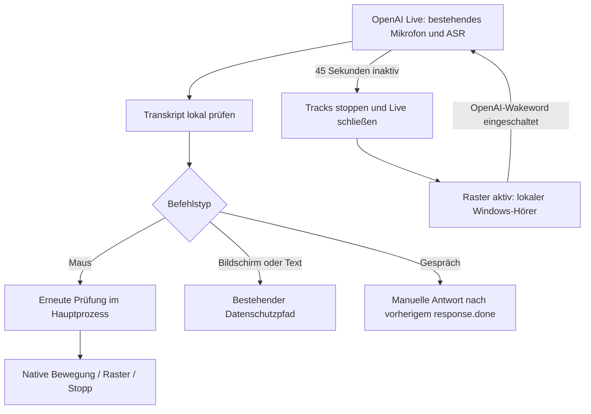

# Maussteuerung 2.0 und sechs Sprachen – Umsetzung und Testnachweis

Historischer Nachweis für den ersten #7-Stand bis `408d1de`.
Aktuelle Korrekturen, natürliche Befehle und Viererunterteilungen:
[ergänzender Nachweis](2026-11-01-mouse-response-quarters.md).

Stand 01.11.2026. Neuer Branch `feature/mouse-grid-2-i18n`, Basis
`feature/mouse-grid-consent` bei `f72dbd32ed9226d7c9370e6ff495cec42096b339`.
Neuer Draft-PR gegen diesen Basisbranch; PRs #4, #5 und #6 bleiben unverändert.
Keine Veröffentlichung, kein Merge und keine Versionsänderung.

**Ausführungsumgebung: Linux, Node v24.19.0 und portable PowerShell 7.4.7.
Noch nicht unter Windows getestet.** Keine echte Audio-, Cursor-, UIA-,
Monitor- oder DPI-Abnahme und keine kostenpflichtigen Live-API-Aufrufe.

## Umgesetzt

| Bereich | Umsetzung |
| --- | --- |
| Raster | Unterteilungen direkt am tatsächlichen Ziel, Elternraster schwach sichtbar, keine Ecklegende; kleine Beschriftungen ausgeblendet; Rahmen auf kleine DIP-Zellen begrenzt. |
| Koordinaten | Bestehende ganzzahlige physische Pixelaufteilung und `screenToDipRect` erhalten; negative Ursprünge und gemischte DPI bleiben Aufgabe der vorhandenen nativen/Electron-Grenze. |
| OpenAI | VAD erzeugt keine automatische Antwort. Vorhandene ASR-Transkripte werden vor einer manuellen Modellantwort gefiltert. Reine Mausbefehle lokal, normale Gesprächsantworten seriell, Desktopaufträge weiter über vorhandene Zustimmung. |
| Nebenläufigkeit | Doppelte Transkripte, verspätete Antwortstarts und Antwortablehnung ohne `response.done` behandelt; Stopp bleibt ausdrücklicher Abbruch, gewöhnliche Spracherkennungsereignisse entziehen keine laufende Desktopfreigabe. |
| Mikrofon | Lokale Prozesse bestätigen Ende, bevor Live/einmaliges Zuhören beginnt. Keine zweite Engine bei fehlender Freigabe. Nach Live-Ende übernimmt ein aktives Raster lokal; OpenAI-Wakeword im Rasterhörer möglich. |
| Sprachen | 450 zentrale UI-Schlüssel in sechs Locales, unabhängig gespeicherte Bediensprache und Antwortsprachen-Präferenz; neue Felder direkt unter einziger KI-Auswahl. |
| Befehle | Sechs lokale Rasterparser/Grammatiken, Zahlen und Buchstabierformen, Richtungen, Stopps und Monitorwahl; fünf zusätzliche begrenzte Desktop-/Textgrundgrammatiken. |
| Erkennung | Exakte `InstalledRecognizers()`-Locale, keine stille Ersatzsprache, verständlicher Text-/Schaltflächenfallback. |
| Bestehendes | Keine Änderungen an Charakterdefinitionen, Stimmen-/Filterimplementierung, Mundanimationen, nativer physischer Mausbewegung oder Zustimmungsschema. Keine Klick-/Tastaturaktionen und keine neuen Abhängigkeiten. |

Die Änderungen sind in getrennten Commits für Zielraster, gemeinsame Live-Transkripte,
Sprachkataloge/Parser, UI-/Mikrofonintegration und technische Dokumentation gegliedert.

## Architektur und Grenzen



Geminis vorhandenes minimales Setup aktiviert keine verlässliche appseitige
Nutzertranskription. Eine Audioverbindung allein reicht nicht, um Rasterbefehle
sicher vor einer Modellantwort abzufangen. Deshalb bleibt das vorhandene Setup
unverändert; Rasterstart beendet Gemini Live und nutzt einen exklusiven lokalen
Hörer. Eine nahtlose Gemini-Integration ist **noch nicht implementiert**.

Der lokale Hörer wartet auf bestätigten Stopp früherer lokaler Prozesse. Nach
Live-Schließen erfolgt die Übernahme nach rendererseitigem Track-Stopp. Erfolgt
keine bestätigte lokale Freigabe innerhalb von zwei Sekunden, bleibt ein neuer
Zugriff gesperrt; Text/Stopp und gegebenenfalls App-Neustart sind die Alternative.
Das tatsächliche Freigabeverhalten von Windows muss praktisch geprüft werden.

Sechs Übersetzungen und Parser sind keine Zertifizierung von sechs Windows-Engines
oder Cloud-Sprachqualitäten. Lokale vordefinierte Charakterkommentare und der einfache
Offline-Fallback können deutsch bleiben. Andere freie Sprachformulierungen als die
implementierten Grammatikvarianten können unerkannt bleiben. Modellantwortsprache
ist eine Präferenz, keine technische Garantie. Oberfläche und native Windows-Dialoge
können unterschiedliche Sprachen haben.

Während OpenAI Live läuft, werden Mausbefehle weiterhin über dessen vorhandenen
Cloud-Audiokanal transkribiert; es gibt keine zusätzliche Raster-API-Verbindung.
Die normale Audio-/Transkriptionsnutzung kann kostenpflichtig sein. Bildschirm und
markierter Text benötigen weiterhin den bisherigen expliziten Auftrag und die
passende App-Zustimmung. Keine privaten Inhalte werden neu protokolliert.

## Ausgeführte Prüfungen

```sh
node --test --test-isolation=none tests/*.test.cjs
```

**472 Tests bestanden, 0 Fehler, Exit 0.** Die Sandbox benötigt diesen vorhandenen
Node-Schalter; der unveränderte normale `npm test`-Befehl bleibt für lokale Systeme.
Der Basisbranch hatte 434 Node-Tests. Tests verwenden Fake-IPC, DOM-Nachbildungen,
Fake-Prozessstreams und simulierte Providerantworten, keine bezahlten Anfragen.

Abgedeckt sind insbesondere:

- Verschachtelung am echten D4-/B3-Bereich, Elternraster, Zurück, Reset, sehr kleine
  Zellen, Tiefengrenzen, Viertelung, Stopp, negative Koordinaten und DPI-Konvertierungsstub.
- OpenAI-Rasterstart ohne Gesprächsende, reine Mausbefehle ohne Antwortanforderung,
  normale Frage nach Befehl, doppelte Ereignisse mit/ohne Item-ID, verspätete Antwort,
  serielle Antworten, API-Ablehnung ohne Abschlussereignis und erneute Bereitschaft.
- Unveränderte 45-Sekunden-Timer und Main-Ablauf nach Live-Schließen: lokales Raster
  übernimmt; aktiviertes OpenAI-Wakeword kann das Gespräch wieder starten; Änderungen am
  Wakeword-Schalter aktualisieren auch einen bereits laufenden lokalen Rasterhörer.
- Alle erzeugten nichtdeutschen Grammatikphrasen durch denselben Parser; deutsche
  Regressionen, Zitate, Verneinungen, unerlaubte Zusatzaktionen und Monitorwahl.
- Alle sechs Sprachwerte über JSON-Neustart; tatsächliche Einstellungsaktionen
  speichern beide Felder unabhängig und erhalten Profile, Freigaben und andere Werte.
- Wiederholter DOM-Sprachwechsel ohne Änderung von Chattexten; Position der neuen
  Felder unter genau einer KI-Auswahl; vollständige sechs Katalogspalten.
- Fehlender Erkenner mit fester Diagnose, exakte Locale-Konfiguration, bestätigte
  Prozessfreigabe, fehlgeschlagener Kill, Timeout und verweigerte fremde/alte IPC-Anfrage.
- Bestehende Charaktere, Stimmen, Klangfilter, Lippenbewegungen, Wakewords, Schlaf,
  Datenschutz, Auswahltext, Bildschirmfunktionen und Providerregressionen.

Weitere Prüfungen auf Linux:

- `tests/read-selection.test.ps1`: **31 bestanden, 0 Fehler**, simulierte UIA-Objekte.
- `tests/mouse-motion.test.ps1`: PASS für Interpolation, negative Pixel, Stopp,
  Ersetzen, ungültige Monitore und begrenzten Cursor; verwaltete C#-Tests mit
  simulierten Betriebssystemgrenzen, keine echten `user32`-Aufrufe.
- PowerShell-Quellen mit portablem PowerShell-7-Parser geprüft; dies ist kein
  Ausführungsnachweis für Windows PowerShell 5.1.
- Geänderte JavaScript-Quellen geparst; Übersetzungsschlüssel/-platzhalter, lokale
  Dokumentationslinks und `git diff --check` geprüft.
- README-Dateien, Version/Abhängigkeiten, Charakter-, Stimmenfilter- und
  Mundanimationsquellen gegen die PR-#5-Basis unverändert.

## Windows-11-Abnahme: noch offen

1. **Start/Erkennung:** Normaler Benutzer, Windows PowerShell 5.1. Jede tatsächlich
   installierte der sechs System.Speech-Engines prüfen. Nicht verfügbare Locale
   wählen: verständlicher Hinweis, keine Ersatzengine, Textfeld und Stopp benutzbar.
   Wakeword und einmaliges Zuhören für jede verfügbare Locale testen.
2. **Oberfläche:** Alle sechs Sprachen einschließlich Menüs, Fehlermeldungen und
   beider Datenschutzdialoge durchgehen. CJK-Schriften, abgeschnittene Texte,
   Tastaturfokus, Screenreader, Scrollbereich und Anzeige bei kleinen Fenstern prüfen.
   Verschiedene Bedien-/Gesprächssprachen speichern und nach App-Neustart prüfen.
3. **Raster:** D4 → Unterteilen → B3 → Unterteilen. Neues Raster muss jeweils im
   echten Ziel erscheinen; Elternlinien bleiben sichtbar, nie eine Ecklegende.
   Tief unterteilen bis Beschriftungen verschwinden, Zurück, Reset, 0/50/100 %
   Sichtbarkeit und gespeicherte Geschwindigkeit/Tiefengrenze prüfen.
4. **Monitore:** 16:9, Ultrawide und Hochkant; links/oberhalb mit negativen Ursprüngen,
   100/125/150/200 % und gemischte Skalierung. Linien, Zielpunkt und echten Zeiger
   vergleichen; Monitorwechsel, Lücken, Hotplug und Auflösungswechsel prüfen.
   Overlay muss durchklickbar bleiben und darf keinen Fokus übernehmen.
5. **OpenAI (freiwillig mit eigenem Schlüssel):** Raster per Sprachbefehl starten,
   D4/Unterteilen/B3, normale Frage, ausdrückliche Bildschirmfrage, „Raster aus“.
   Nur Mausbefehle bleiben ohne KI-Antwort; Gespräch bleibt bestehen. Nach drei
   echten 45-Sekunden-Idle-Disconnects jeweils per Wakeword und Schaltfläche
   erneut starten. Kein konkurrierender lokaler/Live-Mikrofonzugriff.
6. **Gemini:** Bestehendes Live-Gespräch, Rasterstart per Oberfläche/Textfeld,
   bestätigtes Live-Ende vor lokalem Hörer, Rasterende und neuer Gemini-Start.
   Kein nahtloser gemeinsamer Mikrofonbetrieb behauptet. Anbieter- und Sprachwechsel
   während Verbindung/Antwort/Bewegung müssen sicher stoppen. Lokale KI weiter testen.
7. **Stopp:** Lange Bewegung und schnelle Zielwechsel, Sprach-Stopp in allen
   verfügbaren Sprachen, große Stopp-Schaltfläche und Stopp während Initialisierung.
   Ende-zu-Ende-Sprachlatenz messen. Schlaf, Charakter-/Anbieterwechsel und App-Ende
   prüfen. Keine nachlaufenden Ziele, Klicks oder Tastatureingaben.
8. **Datenschutz/Desktop:** Je Bildschirm/Text Abbrechen, Einmal, Dauerhaft,
   Neustart und Widerruf. Bei unveränderter dauerhafter Zustimmung keine erneute
   Frage. Windows-Editor/Browser-UIA, Monitorwahl und Vorlesen nach Rasterbefehlen
   prüfen. Zwischenzeitliche Spracherkennung darf keinen laufenden Auftrag entwerten;
   Stopp, Schlaf, Sitzungsende oder Charakterwechsel müssen ihn abbrechen.
9. **Bestehende Figuren:** Jeffrey, Kelly, Krak, Bronco und James, ihre bisherigen
   Stimmen/Filter und Mundanimationen mit OpenAI, Gemini und lokalen Textantworten.
   Gesprächssprache darf die Stimme nicht durch eine andere Charakterstimme ersetzen.

Diese Prüfung kann API-Kosten verursachen; sie wurde hier nicht durchgeführt.
Kein Release vor praktischer Windows-Abnahme. Noch offen bleiben native Abnahme
und nahtlose Gemini-Maussteuerung, nicht zusätzliche Desktopaktionen.

[Bedienung](../../MAUSSTEUERUNG.md) · [Sprachen und spätere README-Anpassungen](../../MEHRSPRACHIGKEIT.md)
